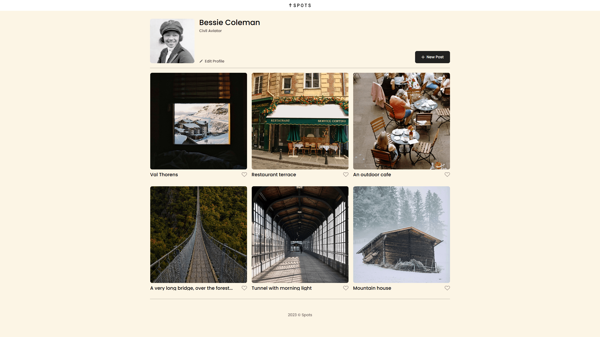
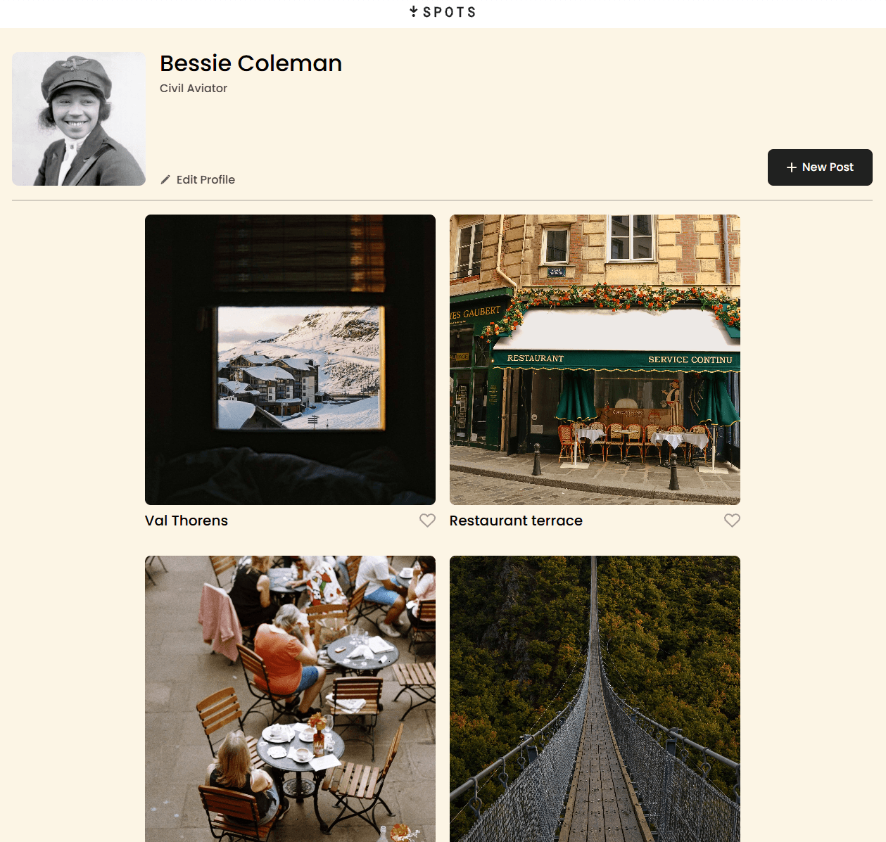
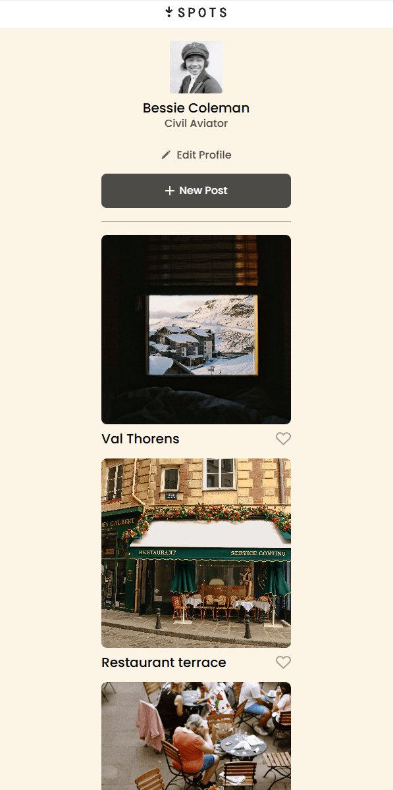

# Spots

Spots is a responsive social photo-sharing webpage created for Sprint 3 of the TripleTen Software Engineering program. The project showcases a profile page with photo cards and the visual interface for editing a profile, adding new posts, and liking photos.

## Project Description

This project presents a profile page for Bessie Coleman with a responsive gallery of photo cards. It includes the page layout and button states for editing profile details, adding new posts, and liking photo cards. JavaScript functionality will be added in a later sprint.

The layout is designed to adapt across desktop, tablet, and mobile screen sizes while keeping the interface clean, readable, and easy to use.

## Functionality

- Profile section with name, description, avatar, and edit button
- New post button
- Photo cards with captions and like buttons
- Display a responsive card grid
- Truncate long card titles with an ellipsis
- Adapt the profile layout for mobile screens
- Maintain consistent spacing and alignment across viewports

## Technologies and Techniques

- HTML5
- CSS3
- Responsive design
- CSS Grid
- Flexbox
- Media queries
- Text overflow handling
- BEM methodology
- Git and GitHub Pages

## Responsive Design Screenshots

### Desktop View

### Tablet View

### Mobile View

## GitHub Pages

[View the deployed project](https://marcwza.github.io/se_project_spots/)

## Project Pitch Video

[Project pitch video](https://drive.google.com/file/d/1pBIYJuFivpCInV1v7-aOe3hWnb_MZbTe/view?usp=sharing)

In the pitch video, I will introduce the Spots project, explain its main features, show how the layout responds across different screen sizes, and describe the technologies used to build it.

## Plans for Improvement

- Add JavaScript in the next sprint so the edit profile and new post buttons can work.
- Make the page even more responsive on different screen sizes.
- Add more cards and experiment with different image layouts.
- Keep improving the spacing, hover states, and small design details.
- Continue improving accessibility as I learn more.
